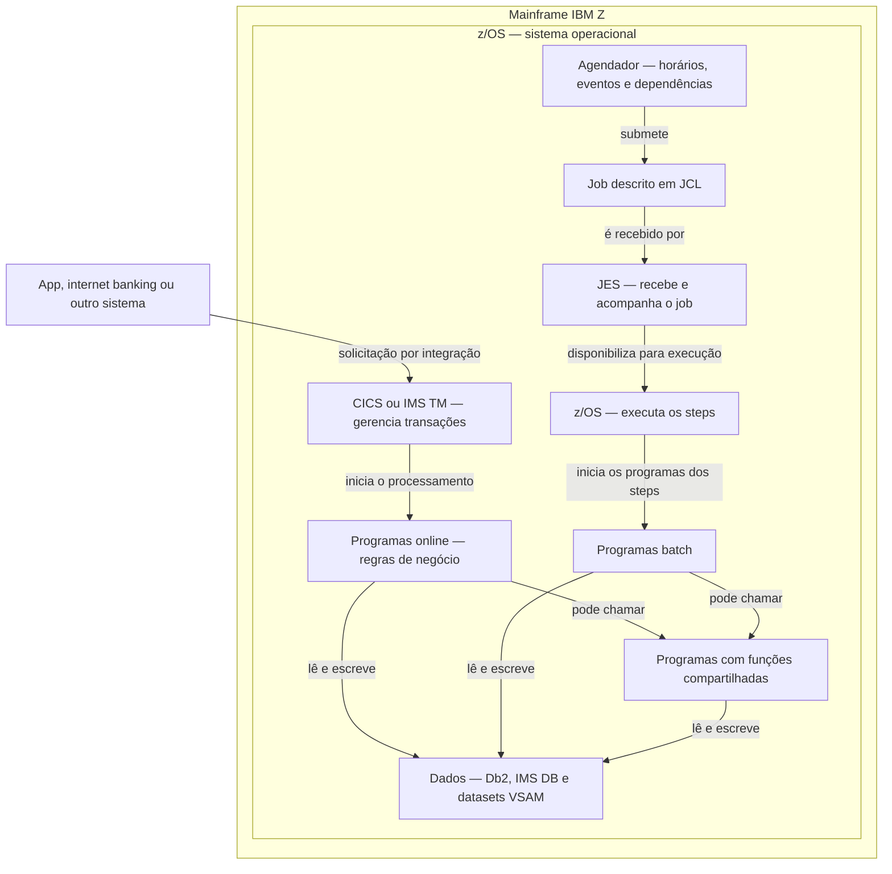
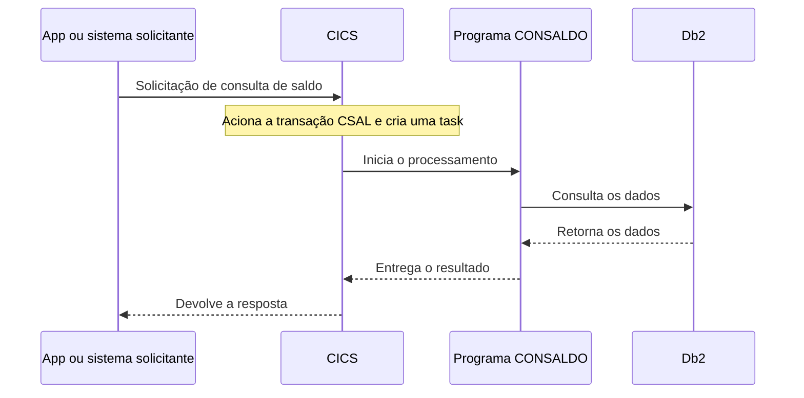
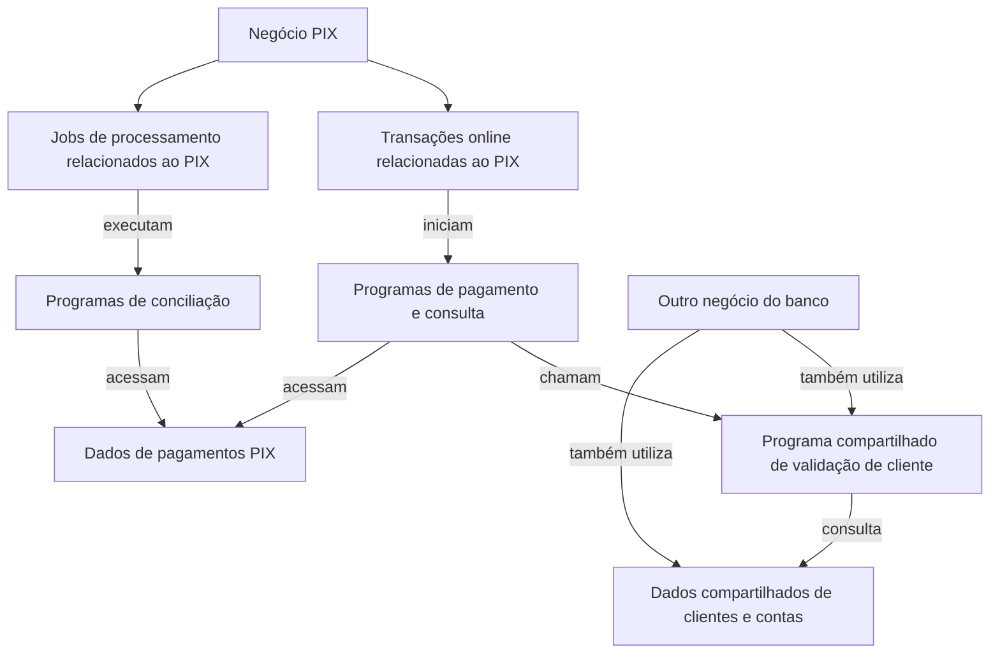

# Como funciona um ambiente mainframe

**Data:** 27/10/2026  
**Objetivo:** entender os elementos da tecnologia mainframe e suas relações para interpretar inventários, mapear negócios e estudar modernização.  
**Leitura complementar:** [Estudo de modernização de mainframe](relatorio_estudo.md).

Este guia usa como referência um ambiente bancário tradicional com IBM Z, z/OS, COBOL, CICS e Db2. Existem outras configurações. Os exemplos de programas, transações e arquitetura PIX são fictícios e não descrevem a implementação do banco.

## 1. A visão geral

**Mainframe é o computador que sustenta o ambiente. Um sistema de negócio é um conjunto de elementos que executa uma função do banco dentro e, frequentemente, fora desse ambiente.**

Um mesmo mainframe pode hospedar vários ambientes e sistemas de negócio. Um sistema de contas, por sua vez, pode envolver muitos programas, transações, jobs, tabelas e integrações.

| Camada | Exemplos | O que faz |
|---|---|---|
| Computador | IBM Z | Oferece processamento, memória e acesso ao armazenamento. |
| Sistema operacional | z/OS | Gerencia recursos, execução de programas, datasets e acesso ao ambiente. |
| Processamento transacional | CICS, IMS TM | Coordena solicitações e a execução dos programas transacionais. |
| Processamento batch | JES, z/OS e agendador | Recebe, acompanha, agenda e executa trabalhos, com responsabilidades distintas. |
| Código de negócio | Programas COBOL, PL/I, Assembler ou Java | Implementa cálculos, validações e outras regras. |
| Armazenamento de dados | Db2, IMS DB, VSAM | Mantém os dados utilizados pelas aplicações. |
| Integração | APIs, IBM MQ e troca de arquivos | Conecta aplicações e ambientes. |

O hardware pode ser dividido em **partições lógicas, chamadas LPARs**, com recursos atribuídos a cada ambiente. Não é necessário estudar esse detalhamento primeiro, mas ele ajuda a entender por que “o mainframe” não é um único processo ou uma única aplicação.

## 2. O funcionamento integrado

Há dois caminhos importantes: atender solicitações online e executar trabalho batch. Ambos podem acessar os mesmos dados e utilizar funções compartilhadas.

**Como ler:**

1. No caminho online, uma solicitação aciona o ambiente transacional, que inicia programas.
2. No batch, um horário ou evento pode liberar um job. O JCL descreve o trabalho; JES e z/OS participam de sua administração e execução.
3. Programas acessam dados e podem chamar outros programas.
4. Compartilhar um programa entre batch e online depende de sua compatibilidade e das interfaces disponíveis. Nem todo programa pode executar nos dois contextos.
5. O diagrama não exige que toda aplicação use simultaneamente CICS, IMS, Db2 e VSAM. Mostra possibilidades de um ambiente.

As setas mostram acionamento e dependência; não representam todos os protocolos, retornos ou controles. Jobs também podem ser submetidos manualmente ou por outras aplicações.

## 3. O que é um programa?

Um **programa** é uma unidade de software que executa uma lógica.

Exemplos:

- Validar uma conta.
- Consultar saldo.
- Calcular juros.
- Atualizar um movimento contábil.
- Gerar um arquivo de cobrança.

Um programa pode executar apenas uma parte da operação e chamar outros programas para completá-la. Programas COBOL normalmente são compilados, gerando código executável.

| Elemento | Significado |
|---|---|
| Código-fonte | Texto que os desenvolvedores mantêm. |
| Programa executável | Resultado preparado para execução no ambiente. |
| Copybook COBOL | Trecho de código ou definição compartilhada, incluído no fonte de outros programas. Não é uma tabela nem, por si só, um programa executado separadamente. |
| Chamada de programa | Relação na qual um programa aciona outro. |

**Para interpretar dados:** contar programas é diferente de contar suas execuções. Um único programa pode executar muitas vezes e participar de várias funções de negócio.

## 4. O que são CICS, IMS TM e transações?

**CICS e IMS TM são gerenciadores de transações e ambientes de processamento de aplicações.** Coordenam o trabalho; as regras específicas do banco ficam nos programas e em outros artefatos da aplicação.

- **CICS:** gerencia a execução de aplicações transacionais e o uso de recursos.
- **IMS TM — Transaction Manager:** gerencia mensagens e a execução dos programas que as processam.

São tecnologias distintas. O nome “IMS” também pode se referir ao banco hierárquico, explicado adiante.

### Uma consulta de saldo no CICS

Uma transação CICS possui um identificador, chamado **TRANSID**, associado a um programa inicial. A execução concreta do trabalho é uma **task**.

No exemplo abaixo, `CSAL` e `CONSALDO` são nomes fictícios. A integração entre o canal e o CICS foi resumida.

O mesmo identificador de transação pode ter várias execuções simultâneas. Um processamento pode envolver vários programas e chamadas a outros ambientes.

### “Transação” pode ter três sentidos

| Contexto | O que significa |
|---|---|
| Negócio | Uma operação, como um pagamento. |
| CICS | Um processamento identificado e controlado pelo gerenciador. |
| Banco de dados | Uma unidade de trabalho cujas alterações podem ser confirmadas ou desfeitas em conjunto. |

Não presuma uma correspondência de um para um. Um pagamento pode atravessar vários sistemas e etapas técnicas.

### O que é uma região CICS?

É um ambiente de execução do CICS, com programas e recursos configurados. Uma aplicação pode atravessar regiões, e uma região pode atender mais de uma aplicação.

Assim, **migrar uma aplicação não significa que toda a região possa ser desligada**.

## 5. O que é batch? Como entram job, step e JCL?

**Batch é processamento sem interação contínua com uma pessoa para solicitar cada operação individual.** Frequentemente trabalha com conjuntos de registros.

Exemplos bancários: calcular encargos, consolidar movimentos, gerar extratos e executar conciliações.

Batch pode executar durante o dia, à noite, em horários definidos ou após um evento, como a chegada de um arquivo.

| Termo | Explicação |
|---|---|
| Job | Unidade de trabalho batch submetida ao ambiente. |
| Step | Etapa do job; pode executar um programa. |
| JCL — Job Control Language | Descreve como executar o trabalho: programas ou procedures, arquivos e parâmetros. |
| JES — Job Entry Subsystem | Recebe jobs e participa da administração de filas, saídas e ciclo do trabalho. |
| Agendador | Coordena calendários, eventos e dependências entre trabalhos. |
| Cadeia batch | Conjunto de jobs relacionados por condições de execução. |
| Janela batch | Intervalo disponível para concluir determinado processamento. |

### Exemplo: consolidação de movimentos

| Job fictício | Programa ou ação |
|---|---|
| `EXTRAI` | Extrai os movimentos para um arquivo. |
| `CONSOL` | Só pode avançar depois que a extração necessária terminou; consolida os registros. |
| `RELATO` | Usa o resultado consolidado para produzir um relatório. |

Cada job pode conter vários steps. Os nomes dos jobs não precisam coincidir com os nomes dos programas.

**JCL descreve o trabalho; o programa implementa a lógica.** Procedures JCL podem reutilizar definições de steps. Utilitários de ordenação e cópia também podem ser executados.

O agendador pode exigir mais que “o job anterior terminou”: chegada de arquivo, término com determinado código ou liberação em um calendário, por exemplo.

## 6. Db2, IMS DB e VSAM são tabelas?

**Não. São tecnologias de armazenamento e acesso a dados com organizações diferentes.**

| Tecnologia | Organização dos dados | Exemplo simplificado |
|---|---|---|
| Db2 | Banco relacional, principalmente com tabelas de linhas e colunas, acessadas por SQL. | Tabelas `CLIENTE` e `CONTA`, relacionadas por identificador. |
| IMS DB — Database Manager | Banco hierárquico, com segmentos organizados em relações pai-filho. | Segmento `CLIENTE` com segmentos filhos `CONTA`. |
| VSAM | Organização e acesso a datasets com registros; o acesso depende do tipo do dataset. | Registros de clientes acessados por uma chave. |

**IMS TM gerencia transações; IMS DB gerencia dados.** São partes distintas da família IMS. Não assuma que uma aplicação utilize ambos.

**Dataset** é o termo do ambiente z/OS para um conjunto de dados. Nem todo dataset é VSAM: há, por exemplo, arquivos sequenciais. Nem todo arquivo representa uma base principal; pode ser uma entrada, saída ou resultado intermediário.

Para inventariar, use os nomes adequados: **tabela Db2, segmento IMS DB e dataset VSAM**.

## 7. Como os sistemas se relacionam?

O relacionamento não se limita a chamadas entre programas.

| Relação | Exemplo hipotético | Por que importa |
|---|---|---|
| Chamada | Um programa consulta outro para validar cliente. | A alteração de uma interface pode afetar consumidores. |
| Leitura e escrita compartilhadas | Online grava movimentos que o batch consolida. | Conecta processamentos sem uma chamada direta entre eles. |
| Arquivo | Um job produz o arquivo que outro consome. | A ordem e o formato do arquivo precisam ser preservados. |
| Mensagem | Uma aplicação publica em uma fila IBM MQ. | Há dependência do conteúdo e da entrega da mensagem. |
| Precedência | Um job depende da conclusão de outro. | Limita a sequência de execução batch. |
| Serviço de execução compartilhado | Dois negócios usam a mesma região CICS. | Retirar um negócio pode não permitir desligar a região. |

A dependência encontrada no código e o uso observado em produção são evidências diferentes. Ausência de execução numa janela curta não prova desuso: fechamentos mensais ou anuais podem não estar representados.

## 8. Como encontrar o que pertence ao negócio PIX?

Comece pelas funções do negócio e identifique entradas online, jobs e suas dependências. O exemplo abaixo é fictício.

As relações de negócio indicam participação, não execução direta. O conjunto pode incluir integrações externas ao mainframe.

### Investigue nos dois sentidos

1. **Do que o PIX depende?** Percorra programas chamados, dados, arquivos, filas e cadeias batch.
2. **Quem mais depende desses elementos?** Identifique consumidores de outros negócios.

Um artefato pode participar de vários negócios. Estar relacionado ao PIX não significa ser exclusivo do PIX.

| Responsabilidade | O que precisamos descobrir |
|---|---|
| Dono da função de negócio | Quem valida o comportamento esperado. |
| Equipe mantenedora do programa | Quem conhece e altera o código. |
| Responsável pelo dado | Quem define seu significado e regras de uso. |
| Equipe de plataforma/operação | Quem administra a execução e os recursos. |
| Equipe de modernização | Quem receberá a execução do trabalho acordado. |

O owner de uma tabela não precisa ser o mesmo owner de todos os programas que a acessam. A equipe mantenedora também não é automaticamente a equipe designada para modernizar.

**Sigla** é uma identificação interna do banco, não uma unidade técnica padronizada da IBM. Confirme se ela representa aplicação, conjunto de programas, produto ou outro agrupamento.

## 9. O que muda ao modernizar para cloud?

A tecnologia pode mudar; o comportamento necessário à operação precisa ter um destino definido.

| Elemento na origem | O que precisa ser tratado |
|---|---|
| Programas e lógica nos dados | Regras, cálculos, validações e resultados. |
| Transações CICS/IMS TM | Entradas, respostas, controle de execução e consistência. |
| JCL e agendador | Steps, parâmetros, arquivos, calendários, precedências e reinício. |
| Db2, IMS DB e VSAM | Dados, estruturas, acessos e condições de migração/coexistência. |
| APIs, MQ e arquivos | Contratos e comunicação com consumidores e produtores. |
| Plataforma | Segurança, disponibilidade, observabilidade e recuperação necessárias. |

As abordagens variam. Algumas preservam programas e comportamentos por meio de ambientes compatíveis; outras transformam código e arquitetura. Portanto, “ir para cloud” não significa automaticamente eliminar COBOL, batch ou todos os mecanismos equivalentes a CICS e IMS.

CICS e IMS TM são serviços de execução. **JCL é um artefato de definição de trabalho, não um serviço que se desliga.**

### Quando desligar recursos na origem?

Somente depois de confirmar o encerramento das dependências que ainda exigem esses recursos, considerando consumidores, dados, operação e o período de coexistência/retorno acordado.

Exemplo: se PIX e cartões compartilham uma região CICS, migrar PIX não elimina a necessidade dessa região para cartões.

Mantenha duas relações diferentes no levantamento:

- **Participa do PIX:** identifica o escopo e os envolvidos.
- **Pode ser retirado após modernizar o PIX:** identifica o que efetivamente deixa de ser necessário na origem.

## 10. Como essa compreensão ajuda a interpretar os dados

| Distinção | Evita qual interpretação errada? |
|---|---|
| Sistema versus programa | Tratar um sistema de negócio como um único executável. |
| Transação definida versus execução | Confundir quantidade de tipos de transação com volume processado. |
| Chamada versus acesso compartilhado | Achar que todo relacionamento aparece no grafo de chamadas. |
| Owner versus equipe executora | Atribuir automaticamente a missão a quem mantém o artefato hoje. |
| Relação técnica versus precedência de modernização | Assumir que o fornecedor precisa sempre migrar antes do consumidor. |
| Caminho crítico batch versus caminho crítico do projeto | Usar duração de execução dos jobs como duração da modernização. |
| MIPS versus esforço | Tratar consumo/capacidade de processamento como complexidade do trabalho. |
| Participação versus exclusividade | Retirar algo utilizado por outro negócio. |
| Modernização versus desligamento | Contabilizar retirada antes de encerrar as dependências na origem. |

Para cada medida de MIPS, confirme definição, método de atribuição ao sistema e janela temporal. O número isolado não informa prazo, dificuldade de migração ou economia financeira.

Este guia não escolhe critérios de priorização nem algoritmos. Ele fornece vocabulário e relações para interpretar a base quando os dados estiverem disponíveis.

## 11. Referências técnicas

As definições se apoiam em documentação oficial; os exemplos e diagramas são sínteses didáticas.

1. **IBM — Mainframe workloads: Batch and online transaction processing.** [Documento](https://www.ibm.com/docs/en/zos-basic-skills?topic=today-mainframe-workloads-batch-online-transaction-processing).
2. **IBM — CICS programs, transactions and tasks.** [Documento](https://www.ibm.com/docs/en/cics-ts/5.6.0?topic=applications-cics-programs-transactions-tasks).
3. **IBM — What is JCL?** [Documento](https://www.ibm.com/docs/en/zos-basic-skills?topic=sdsf-what-is-jcl).
4. **IBM — z/OS concepts.** Conceitos de sistema operacional, processamento e armazenamento. [Livro técnico](https://www.ibm.com/docs/en/zosbasics/com.ibm.zos.zconcepts/zconcepts_book.pdf).
5. **AWS — Transformation of mainframe applications.** Análise de fluxos, programas e dados compartilhados. [Documento](https://docs.aws.amazon.com/transform/latest/userguide/transform-app-mainframe-workflow.html).
6. **AWS — AWS Transform for mainframe Runtime high level architecture.** Serviços que reproduzem comportamentos de execução no destino. [Documento](https://docs.aws.amazon.com/m2/latest/userguide/ba-shared-architecture.html).
7. **IBM — Sharing data in CICS applications.** Recursos e dados compartilhados. [Documento](https://www.ibm.com/docs/en/cics-ts/6.x?topic=applications-sharing-data-in-cics).

Documentação web sujeita a atualização.
